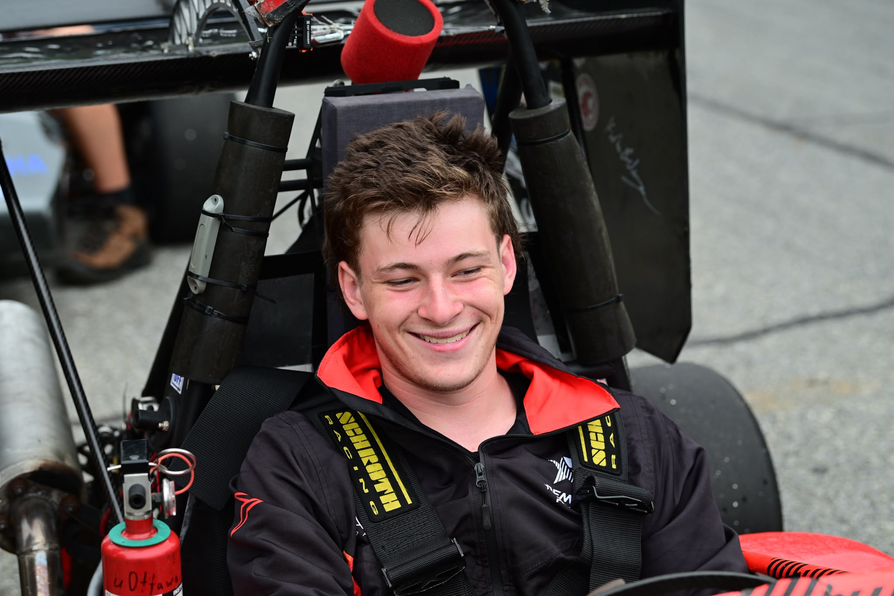

**Chassis Lead**

Benjamin is a second-year Mechanical Engineering student. His Formula experience includes working on race
cars, managing deadlines, teamwork and learning from feedback.

[Read Benjamin Marceau's co-op spotlight]()

[LinkedIn](https://www.linkedin.com/in/benjamin-marceau/)

 
