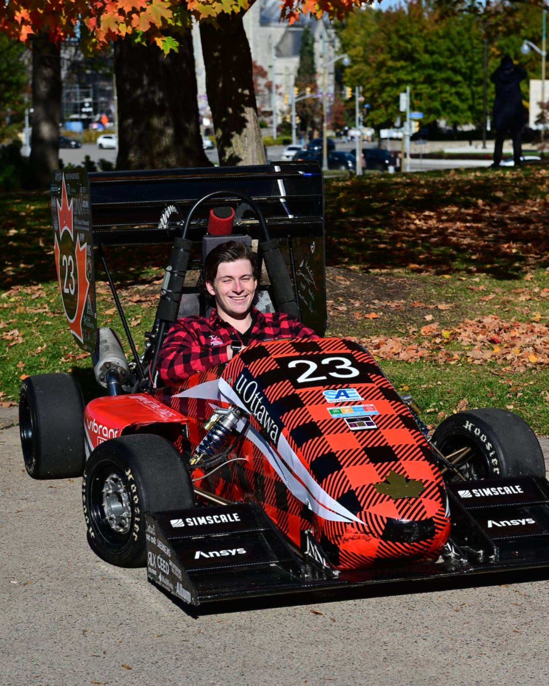

**Chassis Lead**

Benjamin, known as Benji, is a second-year Mechanical Engineering student featured
in the summer co-op spotlights. His Formula experience includes working on race
cars, managing deadlines, teamwork and learning from feedback.

The featured co-op position is Mechanical Engineering Intern at Remstar Racing,
where he analyses race-car data, works with drivers and develops analysis tools.

[Read Benjamin Marceau's co-op spotlight]()

 
