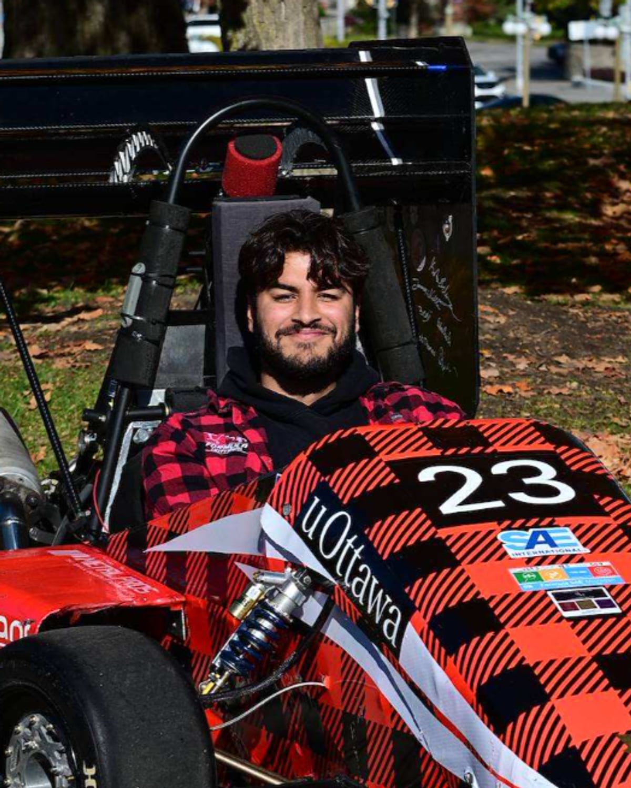

**Aerodynamics Lead**

Hi! My name is Jacob and I’m the Aerodynamics lead for GGR27. I like race cars but I love our race car the most. I’m in 3rd year mechanical engineering and I’m interning at Nokia until April. Formula uOttawa is literally the best thing I do and is where I found my passion for engineering!

[Read Jacob Thomas's co-op spotlight]()

[LinkedIn](https://www.linkedin.com/in/-jt31/)

 
