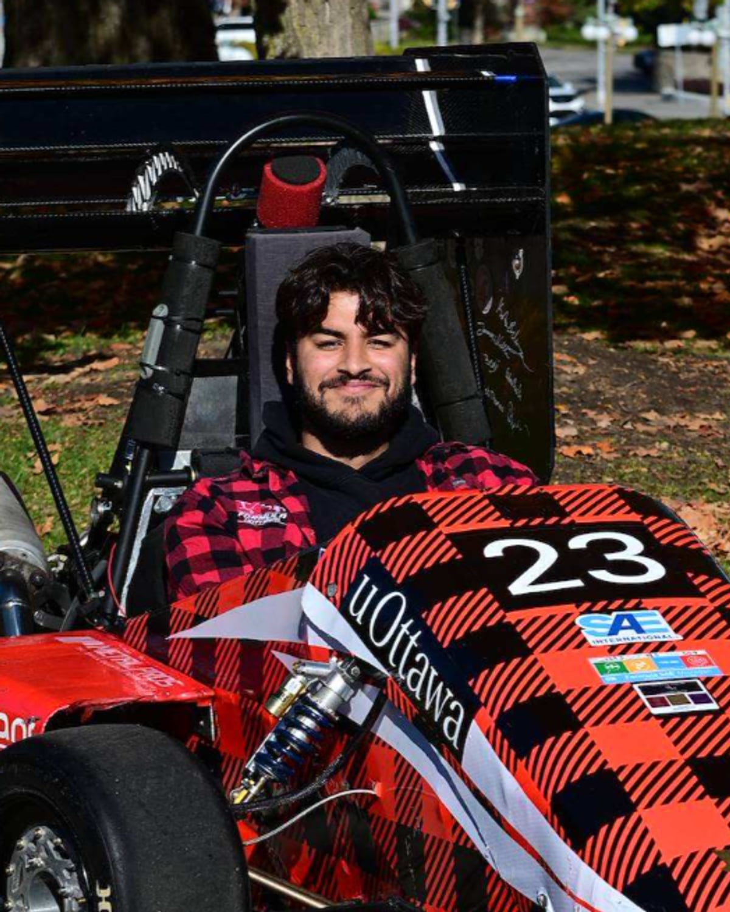

**Aero Lead**

Jacob Thomas is a third-year Mechanical Engineering student featured in the summer co-op
spotlights. Jacob's Formula experience includes carbon fibre manufacturing,
computational fluid dynamics and competition design reviews.

The featured co-op position is Mechanical Engineering Intern at Nokia.

[Read Jacob Thomas's co-op spotlight]()

 
