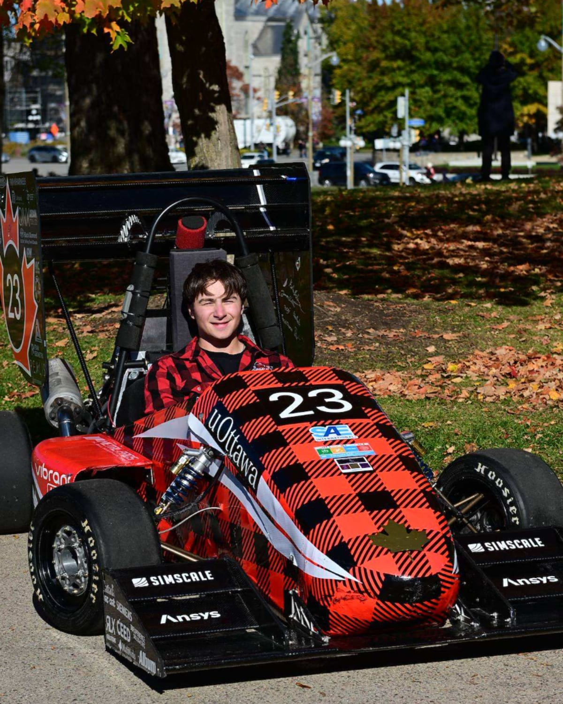

**Aerodynamics & Chassis Associate**

Lennox Yeomans is a third-year Mechanical Engineering student and an
Aerodynamics & Chassis Associate with Formula uOttawa.

As a Systems Engineering Intern at 13 Autosport, Lennox supported the
systems and performance engineering team working on the Chevrolet
Corvette Z06 GT3.R in IMSA.

[Read Lennox Yeomans's co-op spotlight]()

[LinkedIn](https://www.linkedin.com/in/lennox-yeomans/)

 
