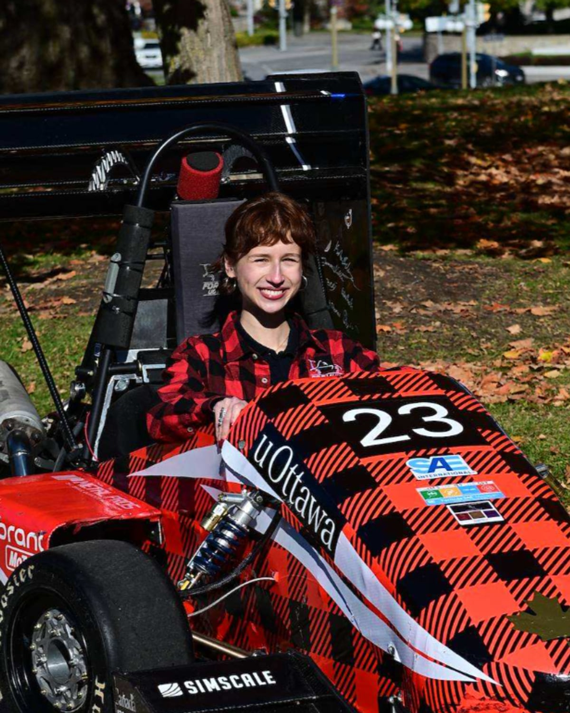

**Team Captain**

Marie is a fifth-year Mechanical Engineering student featured in the summer co-op
spotlights. Marie's Formula experience includes taking race-car components through
research, design, simulation, manufacturing and testing.

The featured co-op position is Mechanical Engineering Intern with BRP's Sea-Doo
R&D team, working on finite element analysis and prototype assembly.

[Read Marie Levin's co-op spotlight]()

 
