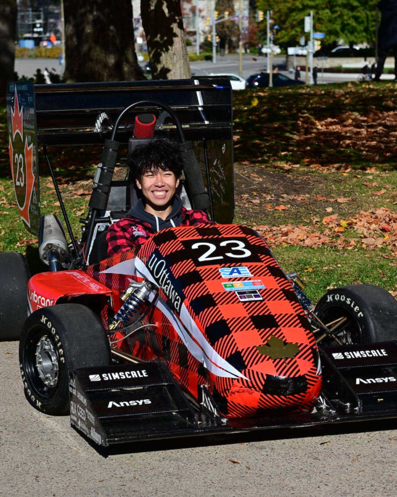

**Electrical Lead**

Samuel Li is a third-year Electrical and Computer Engineering student and
Formula uOttawa's Electrical Lead. Samuel's work with the team includes
PCB design, circuit design and wiring harness development for the GGR25,
GGR26 and GGR27.

The featured co-op position is Electrical Engineer Intern at Thales Canada
Defence and Security.

[Read Samuel Li's co-op spotlight]()

 
